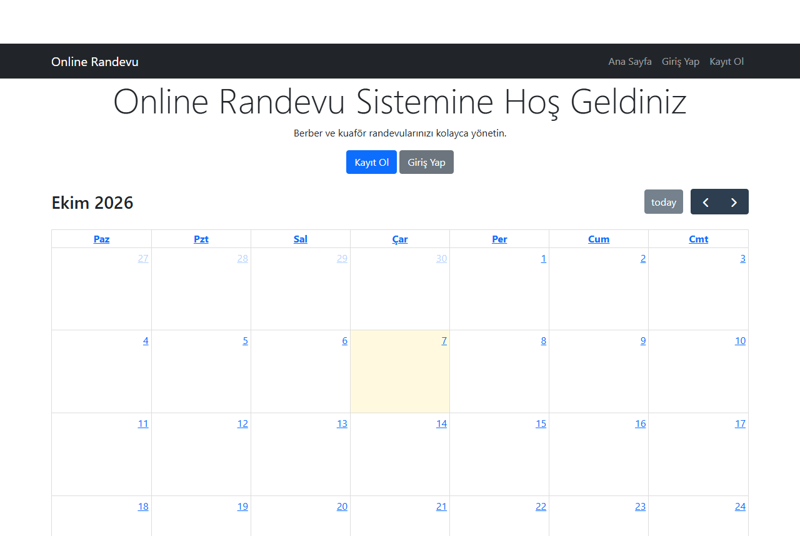

# Online Appointment System (ASP.NET Core)


An appointment booking web app for a barber / hair salon, built with **ASP.NET Core MVC**, **Entity Framework Core** and **ASP.NET Core Identity**.



## Features

- Registration and login with ASP.NET Core Identity
- Book an appointment by picking a service and a time, or by clicking a slot on the calendar
- Weekly and monthly calendar (FullCalendar) showing your own bookings, colored by status
- Cancel upcoming appointments
- Admin panel to confirm, cancel or complete any appointment (role based: `Admin`)
- Booking rules: no past dates, only between 09:00 and 18:00, no overlapping one-hour slots
- Security: users can only see and cancel their own appointments, all state-changing forms use anti-forgery tokens

## Tech

| | |
|---|---|
| Backend | ASP.NET Core 9 MVC, C# |
| Data | Entity Framework Core 9, SQLite |
| Auth | ASP.NET Core Identity with roles |
| Frontend | Razor views, Bootstrap 5, jQuery, FullCalendar |
| Tests | xUnit integration tests with `WebApplicationFactory` and in-memory SQLite |

## Getting started

```bash
cd OnlineRandevuSistemi
dotnet run
```

The database (`randevu.db`) is created and migrated on first start. In the Development environment an admin account is created from `appsettings.Development.json`:

```
admin@example.com / Admin123
```

## Tests

```bash
dotnet test
```

The integration tests run the real application pipeline and check booking rules, access control (a user cannot cancel or see another user's appointment) and the admin role requirement.

## Project structure

```
OnlineRandevuSistemi/
├── Controllers/          # Home, Appointment, Admin
├── Data/                 # DbContext, migrations, seed data (roles + admin)
├── Models/               # Appointment and status
├── Views/
└── Program.cs
OnlineRandevuSistemi.Tests/
└── AppointmentTests.cs   # End-to-end tests
```
